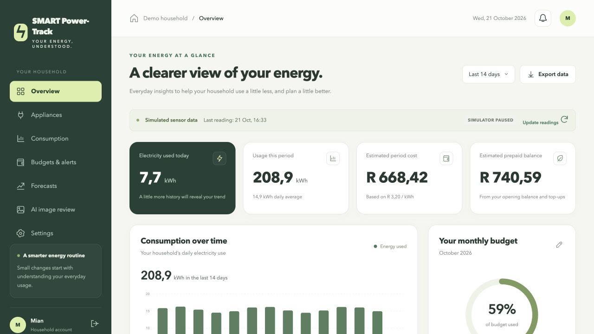

# SMART Power-Track

A runnable student prototype for household electricity monitoring, budgeting, forecasts and reviewed image capture. It uses Java 17, Spring Boot, JDBC and a browser interface. Sensor readings are **simulated**, costs and prepaid balances are **estimates**, and the image workflow uses **demonstration suggestions or manual entry**. No external AI extraction service or live electricity meter is connected.

This is a development prototype for the Phase 4/5 work. The application and these notes do not by themselves establish completion of the academic submission, real household research, measured forecast accuracy, production security or acceptance by a lecturer.



## Start locally

Install Java 17 or later. The supplied runnable JAR needs only Java; Maven 3.9 or later is needed when building from source. The macOS/Linux Maven launcher can download a local Maven installation for that build. Keep the project folder writable because the local database and uploaded images are saved inside `data/`.

From the project folder:

```sh
./start.sh
```

On Windows, run `start.cmd`. On macOS, `Start-Power-Track.command` is also available as a clickable launcher. If using Maven directly:

```sh
mvn spring-boot:run
```

Open **http://127.0.0.1:8080**. The default configuration listens only on the local computer.

| Demo login | Value |
|---|---|
| Email | `demo@powertrack.local` |
| Password | `PowerTrack123!` |

The demo account is intentionally shared demonstration data. Register a separate account to check household isolation. New accounts start empty; the sample-data action can load an illustrative history for that account. Reset affects the signed-in account's demo data, so do not use it to keep important records.

## What to demonstrate

- Register and sign in; add an appliance and its simulated sensor.
- Review consumption by day and appliance, energy coverage and the latest reading timestamp.
- Run or enable the simulator, set a monthly budget, and view alerts.
- Record a prepaid opening amount and top-ups; inspect the estimated balance.
- Request a forecast when enough complete historical days are available.
- Upload an image for manual value entry, or load a clearly labeled demonstration sample; confirm, correct or reject its proposed value.
- Export consumption records as CSV and change household settings.

Windows users can follow the [complete setup guide](docs/WINDOWS-SETUP.md).

See [the demo walkthrough](docs/DEMO-GUIDE.md) for a repeatable presentation sequence.

## Data and calculations

H2 is the default local, file-based database. It is chosen so the prototype can run without installing a database server; this is a deliberate implementation variation from Phase 2's MySQL plan. The optional MySQL profile is available for further verification.

Readings carry average power in watts and a positive interval duration. Energy is `powerW / 1000 × intervalSeconds / 3600`. Readings are timestamped at the **end** of the interval. Duplicate and overlapping intervals must be rejected, and missing intervals reduce the displayed coverage. Household totals are derived from simulated appliance totals. Confirmed bills are kept as separate manual household records rather than added again to those totals. A cumulative meter observation is not treated as interval consumption.

Estimated cost uses the configured flat currency-per-kWh rate. It does not model a utility's full block tariff, fixed charges, taxes or billing reconciliation. Prepaid estimates use an opening amount plus subsequent top-ups minus simulated consumption costs since that opening; they are not an authoritative utility balance. Changing tariff assumptions can change estimates.

The simple forecast uses seven recent complete days with adequate coverage. It shows its history and forecast periods; insufficient history produces an unavailable result. A holdout error can be calculated only when enough earlier history exists. Demonstration patterns and holdout results on simulated data do not establish accuracy for real households.

## Image capture modes

There is **no configured external AI provider** in this prototype. A real uploaded image receives no invented extracted number: the user enters and reviews the value. The sample action supplies an illustrative suggestion from a known fixture. Pending values cannot change accepted records until confirmed and validated.

Appliance values update the linked appliance rating. Meter values remain observations. Bill values require a valid period and become separate manual household records. Rejection leaves accepted records unchanged. Processing state and user-review state are stored separately.

## Configuration

| Environment variable | Default / purpose |
|---|---|
| `PORT` | `8080` |
| `SERVER_ADDRESS` | `127.0.0.1` |
| `DB_URL` | Local H2 file at `./data/powertrack` |
| `DB_USER`, `DB_PASSWORD` | Database credentials; default H2 user `sa`, empty local password |
| `UPLOAD_DIR` | `./data/uploads` |
| `DEMO_SEED` | `true`; prepares the demonstration account |
| `SPRING_PROFILES_ACTIVE` | Set to `mysql` to use the optional MySQL configuration |

For MySQL, create an empty database named `powertrack` and a restricted database user, then configure the `mysql` profile and credentials. A different server can be selected with `DB_URL`, for example `jdbc:mysql://localhost:3306/powertrack?serverTimezone=Africa/Johannesburg`. MySQL support must be checked against the target server before claiming compatibility; running the H2 test suite does not verify it.

The prototype stores password hashes, uses session authentication and checks a CSRF token on mutations. Uploaded files are served through account-scoped endpoints. Public deployment additionally needs HTTPS, secure deployment-specific cookie configuration, secret management, image retention, backup procedures and a security review. Do not place real bills or sensitive personal images in the demonstration account.

## Build and test

```sh
mvn test
mvn package
java -jar target/smart-power-track-0.1.0.jar
```

Integration tests use a separate in-memory H2 database with demo seeding disabled. They exercise actual HTTP handlers rather than relying only on isolated calculation mocks. The development run on **21 October 2026** passed **15 tests: 10 HTTP integration checks and 5 analytics checks**, using Java 25.0.3 and H2. Java 17 compatibility and MySQL execution were not separately tested in that run. See [requirements](docs/REQUIREMENTS.md) and [the test plan](docs/TEST-PLAN.md) for scope and remaining checks. Test execution evidence is the generated `target/surefire-reports/` output from the run.

## Backup and restore for the local demo

Stop the application before copying `data/`; retain the H2 database file and the uploads directory together. Restore into the same project location with the application stopped, then restart and check record counts, relationships and image access. Copying only the database does not preserve image files. The stopped-database copy/restore procedure was verified during development; see `docs/test-evidence/restore-check.json`.

## Documentation

- [Shared API and data contract](docs/API-CONTRACT.md)
- [Requirements and implementation boundaries](docs/REQUIREMENTS.md)
- [Demonstration guide](docs/DEMO-GUIDE.md)
- [Test plan and acceptance checks](docs/TEST-PLAN.md)

The Phase 3 questionnaire responses were simulated requirements-analysis profiles. They must not be presented as interviews that actually took place.

## Prebuilt group package

The downloadable package includes `app/smart-power-track.jar`, so no Maven download is needed to run it. Install Java 17 or newer, extract the complete folder, then run `Start-Power-Track.command` on macOS, `start.cmd` on Windows, or `./start.sh` on Linux. The development runtime was Java 25.0.3. Open http://localhost:8080 and use the demo button or credentials above. Stop the application with Ctrl+C in its terminal.

## Verified evidence

See `docs/test-evidence/`: 15 passing functional tests, a local 30-request benchmark across six concurrent sessions (same seeded demo household), and a stopped-database copy/restore check including a protected confirmed image. The benchmark does not establish production capacity or six different households. MySQL integration and Java 17 execution remain to be verified separately.

Costs, including CSV exports, use the currently configured flat tariff assumption. Changing it recalculates estimates; this prototype does not preserve historical effective-dated tariffs. Real uploaded images use manual entry; sample images provide labelled fixture suggestions. No live AI service is configured.

Official Spring Boot requirements: https://docs.spring.io/spring-boot/3.5/system-requirements.html
